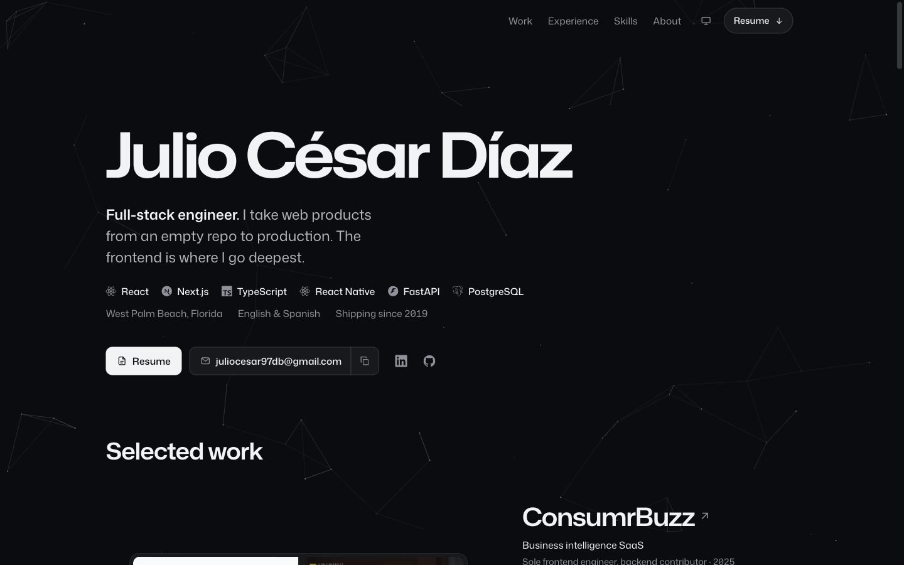

# Julio César Díaz · Portfolio

The source of **[juliocesardb.com](https://www.juliocesardb.com)**: a single-page portfolio and a print-ready resume, both rendered from one JSON file.

[](https://www.juliocesardb.com)

## What it is

A static site that answers three questions for someone hiring an engineer: what has he built, what does he work with, and where has he worked.

- **Selected work.** One lead project and three features, each with a real screenshot. The lead project traces the layers a request crosses.
- **Experience.** Every role with its dates, its headline result, the projects built there and the stack used.
- **Skills.** Each core skill sits next to the projects that used it. The list is computed from the projects' own keywords, so a skill cannot be claimed without work behind it.
- **Resume.** `/resume` renders the same data as a two-page Letter document; the downloadable PDF is that page printed.

Light and dark themes follow the system and can be pinned from the top bar.

## Stack

| | |
| --- | --- |
| **Framework** | [Astro 7](https://astro.build), static output, no client framework |
| **Styling** | [Tailwind CSS 4](https://tailwindcss.com), configured in CSS through `@theme` |
| **Language** | TypeScript; `astro check` runs before every build |
| **Type** | Mona Sans Variable and Geist Mono Variable, self-hosted through Fontsource |
| **Icons** | One hand-drawn stroke set, plus technology marks from [simple-icons](https://simpleicons.org) inlined at build time |
| **Client JavaScript** | Three small modules, no dependencies: interactions, theme, and the particle field |

## One source of truth

All content lives in [`cv.json`](cv.json), imported through the `@cv` alias and typed in [`src/cv.d.ts`](src/cv.d.ts). Components hold layout, never copy.

| Key | Feeds |
| --- | --- |
| `basics` | Name, role, tagline, contact, the About paragraphs, `coreSkills` and the grouped `toolkit` |
| `work` | Experience roles: summary, headline `metric`, highlights and `skills` |
| `projects` | Selected work. `tier` decides placement: `lead`, `feature`, `more` (shown on its role) or `hidden` |
| `education`, `languages` | The About facts and the resume footer |

Change a date, a title or a stack in `cv.json` and the home page and the resume change together.

### Adding a project

1. Put a screenshot in `public/projects/` (WebP, 900 × 560).
2. Add an entry to `projects` in `cv.json`:

   ```json
   {
     "name": "Project name",
     "title": "Project name",
     "tier": "feature",
     "kind": "What it is, in a few words",
     "role": "Your part in it",
     "image": "/projects/project-name.webp",
     "imageAlt": "What the screenshot shows",
     "description": "One or two sentences on what it does.",
     "facts": ["A concrete thing it does", "Another"],
     "keywords": ["Next.js", "TypeScript"],
     "url": "https://example.com",
     "year": "2026",
     "madeAt": "Employer name, or Personal",
     "isActive": true,
     "highlights": []
   }
   ```

Its `keywords` are what place it next to a skill, and `madeAt` is what attaches it to a role.

## Resume

[`src/pages/resume.astro`](src/pages/resume.astro) is a single column of real text, in reading order, so applicant tracking systems parse it cleanly. To refresh `public/resume.pdf` after editing `cv.json`:

1. Run the site and open `/resume`.
2. Print to PDF: Letter, default margins off (the page sets its own), background graphics on.
3. Save over `public/resume.pdf`.

The page is marked `noindex`. The download buttons serve the PDF as `Julio-Cesar-Diaz-Resume.pdf`.

## Getting started

Requires Node.js 22.23 or newer.

```bash
npm install
npm run dev
```

Then open [localhost:4321](http://localhost:4321).

| Command | Action |
| --- | --- |
| `npm run dev` | Start the dev server |
| `npm run build` | Type-check with `astro check`, then build to `dist/` |
| `npm run preview` | Serve the production build locally |

## Project structure

```text
.
├── cv.json                    # All site and resume content
├── astro.config.mjs           # Tailwind plugin, the @cv and @ aliases, the /archive redirect
├── DESIGN.md                  # The design system: tokens, components, named rules
├── PRODUCT.md                 # Audience, positioning and content rules
├── public/
│   ├── projects/              # Project screenshots
│   └── resume.pdf             # /resume, printed
└── src/
    ├── components/
    │   ├── sections/          # Work, Experience, Skills, About, Contact
    │   ├── Hero.astro
    │   ├── TopBar.astro       # Scroll-linked glass bar and section nav
    │   ├── ThemeMenu.astro
    │   ├── EmailActions.astro
    │   └── ParticleBackground.astro
    ├── icons/                 # Icon.astro (UI), TechIcon.astro (technology marks)
    ├── layouts/Layout.astro   # <head>, metadata, fonts
    ├── pages/                 # index.astro (/) and resume.astro (/resume)
    ├── scripts/               # interactions.ts, theme.ts, particles/
    ├── styles/global.css      # Tokens, base and component layers
    ├── utils/                 # Dates, anchors, resume file name
    └── cv.d.ts                # Types for cv.json
```

## Design

The visual system is written down in [`DESIGN.md`](DESIGN.md): a cool grey ladder with one ultramarine accent reserved for things a visitor can act on, Mona Sans carrying hierarchy through its width axis, and product screenshots as the only raised objects on the page. [`PRODUCT.md`](PRODUCT.md) records who the site is for and what it will and will not claim.

Motion is scroll-linked or one-shot, and all of it stands down under `prefers-reduced-motion`. The accessibility floor is WCAG 2.2 AA: keyboard navigation, visible focus, a correct heading outline and 44px touch targets.

## License

[MIT](LICENSE.txt) © Julio César Díaz
