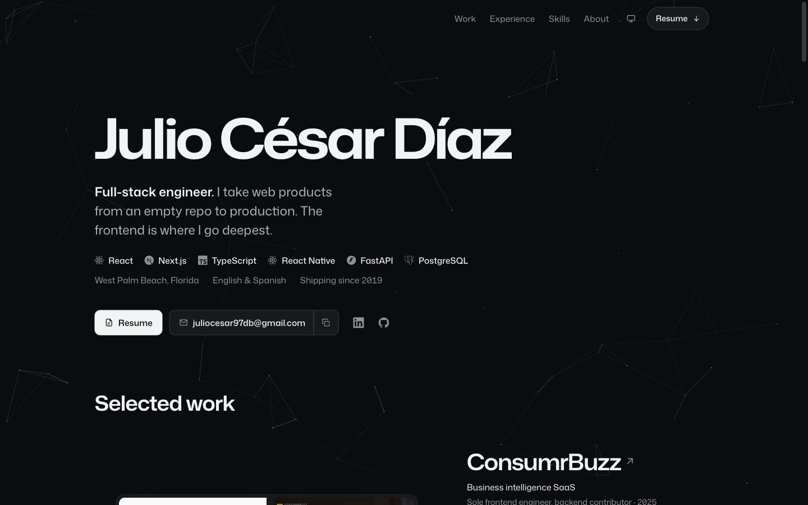

<div align="center">

# Julio César Díaz · Portfolio

The source of **[juliocesardb.com](https://www.juliocesardb.com)**: a single-page portfolio and a print-ready resume, both rendered from one JSON file.

**[Live site](https://www.juliocesardb.com)** · **[Resume](https://www.juliocesardb.com/resume)** · **[Resume PDF](https://www.juliocesardb.com/resume.pdf)**

<p>
  <a href="https://github.com/JulioCesar97DB/JulioCesarDB-portfolio/actions/workflows/ci.yml"></a>
  <a href="https://github.com/JulioCesar97DB/JulioCesarDB-portfolio/actions/workflows/deploy.yml"></a>
  <a href="LICENSE.txt"></a>
</p>

<p>
  <a href="https://astro.build"></a>
  <a href="https://tailwindcss.com"></a>
  <a href="https://www.typescriptlang.org"></a>
  <a href="https://nodejs.org"></a>
  <a href="https://aws.amazon.com/amplify/"></a>
  <a href="https://github.com/JulioCesar97DB/JulioCesarDB-portfolio/actions"></a>
</p>

<br>

<a href="https://www.juliocesardb.com"></a>

</div>

<br>
<p align="center">
  <a href="#what-it-is">What it is</a> ·
  <a href="#stack">Stack</a> ·
  <a href="#one-source-of-truth">One source of truth</a> ·
  <a href="#resume">Resume</a> ·
  <a href="#search-and-sharing">Search and sharing</a> ·
  <a href="#run-it-locally">Run it locally</a> ·
  <a href="#hosting-and-deployments">Hosting</a> ·
  <a href="#project-structure">Structure</a> ·
  <a href="#design">Design</a> ·
  <a href="#license">License</a>
</p>

## What it is

A static site that answers three questions for someone hiring an engineer: what has he built, what does he work with, and where has he worked.

- **Selected work.** One lead project and three features, each with a real screenshot. The lead project traces the layers a request crosses.
- **Experience.** Every role with its dates, its headline result, the projects built there and the stack used.
- **Skills.** Each core skill sits next to the projects that used it. The list is computed from the projects' own keywords, so a skill cannot be claimed without work behind it.
- **Resume.** `/resume` renders the same data as a two-page Letter document; the downloadable PDF is that page printed.

Light and dark themes follow the system and can be pinned from the top bar.

## Stack

| Layer | Choice |
| --- | --- |
| **Framework** | [Astro 7](https://astro.build), static output, no client framework |
| **Styling** | [Tailwind CSS 4](https://tailwindcss.com), configured in CSS through `@theme` |
| **Language** | TypeScript; `astro check` runs before every build |
| **Type** | Mona Sans Variable, self-hosted and cut to the characters the page sets; the system monospace for dates. The resume also sets Geist Mono |
| **Icons** | One hand-drawn stroke set, plus technology marks from [simple-icons](https://simpleicons.org) inlined at build time |
| **Client JavaScript** | Three small modules, no dependencies: interactions, theme, and the particle field |
| **Hosting** | [AWS Amplify](https://aws.amazon.com/amplify/), deploying every push to `main` |
| **CI** | GitHub Actions on Node 24: type-check and build, then a check that each deploy went live |

## One source of truth

All content lives in [`cv.json`](cv.json), imported through the `@cv` alias and typed in [`src/cv.d.ts`](src/cv.d.ts). Components hold layout, never copy.

| Key | Feeds |
| --- | --- |
| `basics` | Name, role, tagline, contact, the About paragraphs, `coreSkills` and the grouped `toolkit` |
| `work` | Experience roles: summary, headline `metric`, highlights and `skills` |
| `projects` | Selected work. `tier` decides placement: `lead`, `feature`, `more` (shown on its role) or `hidden` |
| `education`, `languages` | The About facts and the resume footer |

The home page and the resume read the same data, so they never disagree. A project's `keywords` place it next to the skills it proves, and its `madeAt` attaches it to the role it was built in. Project screenshots live in `src/assets/projects/` and ship as AVIF with a WebP fallback at three widths.

## Resume

[`src/pages/resume.astro`](src/pages/resume.astro) is a single column of real text, in reading order, so applicant tracking systems parse it cleanly. `public/resume.pdf` is that page printed to Letter, and the download buttons serve it as `Julio-Cesar-Diaz-Resume.pdf`. The page is marked `noindex` and left out of the sitemap.

## Search and sharing

- Title and description come from `basics.seo` in `cv.json`, written to fit a search result (about 55 and 150 characters).
- A `ProfilePage` / `Person` JSON-LD block is built from `cv.json` in the layout.
- `/robots.txt` and `/sitemap.xml` are generated at build time; the site URL is set once, as `site` in `astro.config.mjs`.
- The stylesheet is inlined, the text font is preloaded, and screenshots ship as AVIF with a WebP fallback.

## Run it locally

CI uses Node 24; Astro 7 needs Node 22.23 or later.

```sh
npm ci
npm run dev       # dev server at http://localhost:4321
npm run build     # astro check, then the static build in dist/
npm run preview   # serve dist/ locally
```

`npm run fonts` re-cuts the self-hosted Mona Sans file to the characters the page sets ([`scripts/subset-fonts.mjs`](scripts/subset-fonts.mjs)).

## Hosting and deployments

[AWS Amplify](https://aws.amazon.com/amplify/) builds and deploys every push to `main`; build settings live in the Amplify console and response headers in [`customHttp.yml`](customHttp.yml). Each build publishes the commit it was built from at [`/version.json`](https://www.juliocesardb.com/version.json), which is never cached, and in a `<meta name="build-commit">` tag on every page.

Two GitHub Actions workflows run alongside it:

- [**CI**](.github/workflows/ci.yml) type-checks and builds every pull request and every push to `main`.
- [**Production deployment**](.github/workflows/deploy.yml) records each push to `main` as a deployment to the `production` environment, polls `/version.json` and the page until both report that commit, and fails after 15 minutes if they do not. A newer push cancels the wait for an older one. Use **Re-run all jobs** to check a push again: it first asks whether the commit is still the head of `main`, and records nothing if a newer commit has replaced it. **Re-run failed jobs** cannot ask again, so it skips the check. It holds no AWS credentials; it only reads the public site.

Skip markers act on one side only: `[skip ci]` (or GitHub's other markers, such as `[skip actions]`) in a commit message skips this workflow while Amplify still deploys, so no deployment is recorded; Amplify's `[skip-cd]` skips the deploy, so the workflow fails after its 15 minutes.

## Project structure

<details>
<summary>The tree, with what each part holds</summary>

```text
.
├── cv.json                    # All site and resume content
├── astro.config.mjs           # Tailwind, aliases, /archive redirect, build-time resume size and commit
├── .github/workflows/         # ci.yml (type-check and build), deploy.yml (production deployment)
├── customHttp.yml             # Response headers for AWS Amplify: caching, security, no-store /version.json
├── scripts/
│   ├── subset-fonts.mjs       # npm run fonts: cuts the self-hosted fonts to the page's characters
│   └── wait-for-deploy.mjs    # Polls /version.json and the page until the live site serves a commit
├── DESIGN.md                  # The design system: tokens, components, named rules
├── PRODUCT.md                 # Audience, positioning and content rules
├── public/
│   ├── og.png                 # Social preview image
│   └── resume.pdf             # /resume, printed
└── src/
    ├── assets/projects/       # Project screenshots, optimized at build time
    ├── components/
    │   ├── sections/          # Work, Experience, Skills, About, Contact
    │   ├── Hero.astro
    │   ├── TopBar.astro       # Scroll-linked glass bar and section nav
    │   ├── ThemeMenu.astro
    │   ├── EmailActions.astro
    │   └── ParticleBackground.astro
    ├── icons/                 # Icon.astro (UI), TechIcon.astro (technology marks)
    ├── layouts/Layout.astro   # <head>, metadata, fonts
    ├── pages/                 # index.astro (/), resume.astro (/resume), robots.txt, sitemap.xml, version.json
    ├── scripts/               # interactions.ts, theme.ts, particles/
    ├── styles/global.css      # Tokens, base and component layers
    ├── utils/                 # Dates, anchors, resume file name
    └── cv.d.ts                # Types for cv.json
```

</details>

## Design

The visual system is written down in [`DESIGN.md`](DESIGN.md): a cool grey ladder with one ultramarine accent reserved for things a visitor can act on, Mona Sans carrying hierarchy through its width axis, and product screenshots as the only raised objects on the page. [`PRODUCT.md`](PRODUCT.md) records who the site is for and what it will and will not claim.

Motion is scroll-linked or one-shot, and all of it stands down under `prefers-reduced-motion`. The accessibility floor is WCAG 2.2 AA: keyboard navigation, visible focus, a correct heading outline and 44px touch targets.

## License

[MIT](LICENSE.txt) © Julio César Díaz
